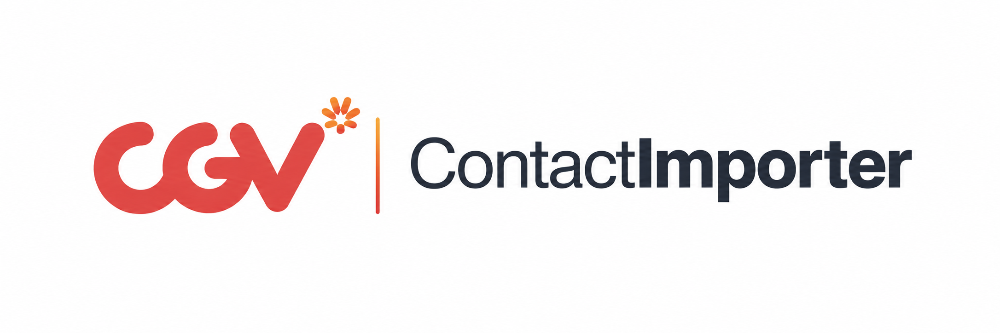

<p align="center">
  
</p>

<p align="center">
  Excel/CSV → VCF contact importer with customizable mapping, campaign metadata, and a permanent Google Sheets backend.
</p>

# CGV | ContactImporter

ContactImporter converts spreadsheet contact data into a single `.vcf` file for bulk import into phone/contact applications. Spreadsheet parsing and VCF generation happen in the browser. A permanent Google Apps Script backend can sync validated contacts to the designated Google Sheet when the user explicitly requests it.

## Features

- Import `.xlsx`, `.xls`, and `.csv` files.
- Drag-and-drop or file-picker upload.
- Custom column mapping for **Name**, **Phone Number**, **E-mail**, and **Notes**.
- Auto-detects common Indonesian and English contact headers, including **Nama Lengkap**, **No Whatsapp**, and **Email Address**.
- Finds the header row even when a Google Forms/event title appears above it; lets you change the worksheet and header row.
- Recognizes **Jumlah Penonton / Jumlah Peserta** as optional registration details and preserves values in VCF contact notes and the manual backend sync.
- Can copy a detected worksheet event title into the campaign name on request.
- Exports only rows containing a Full Name plus a Phone Number, E-mail, or both.
- Normalizes Indonesian-style name capitalization before export.
- Supports event/campaign name, lead source, category, batch notes, and per-contact spreadsheet notes.
- Custom saved-name formats for campaign contacts.
- Live contact preview and import statistics.
- Generates one bulk VCF file in the browser.
- Responsive studio interface with monochrome cards, lilac accents, pill navigation, and visible keyboard focus.
- Forced update prompt for newer GitHub Pages deployments.
- Permanent Google Sheets + Apps Script backend with manual push/pull sync.

## Spreadsheet mapping

ContactImporter identifies the worksheet with the strongest contact headers and detects the actual header row (including sheets with an event title above the headers). You can change the worksheet or header row manually in Import; headerless sheets can be mapped with Column A/B/C labels.

After import, choose which spreadsheet columns represent:

- Full Name — required
- Phone Number — optional
- E-mail — optional
- Notes — optional
- Extra registration detail (such as **Jumlah Penonton**) — optional; its labeled value is appended to each contact note

A row is included only when it matches:

```text
Full Name AND (Phone Number OR E-mail)
```

Notes do not make an otherwise invalid row exportable.

## Name normalization

ContactImporter cleans repeated spaces and normalizes name capitalization before writing the VCF. It preserves common initials and handles common Indonesian/foreign name particles such as `bin`, `binti`, `al`, `van`, and `de` without attempting to guess or replace a person's actual name.

## Campaign metadata

Each exported contact can include:

- Event / Campaign Name
- Lead Source
- Category
- Per-contact mapped Notes
- Batch-level Additional Note

Campaign information can also be appended or prepended to the saved contact name.

## Permanent Google Sheets backend

ContactImporter includes the Google Apps Script backend in:

```text
google-apps-script/
├── Code.gs
├── appsscript.json
└── README.md
```

The production frontend is permanently locked to:

```text
https://script.google.com/macros/s/AKfycbyLKEpsopYNkJlMf_65tfOyyPwTeOXUnl-Juk7gXX4R9nSOj4PmGpdT3ILL0cO-v_5fsw/exec
```

Users cannot replace, edit, save, or disconnect the backend from the ContactImporter interface. Changing the endpoint requires changing the repository and deploying a new ContactImporter build.

The backend supports:

- connection health checks
- upsert/sync of current contacts
- loading saved contacts back into ContactImporter
- sync history logging
- de-duplication by phone first, then e-mail

### Apps Script setup / update

1. Open the Google Sheet that should permanently store ContactImporter data.
2. Open **Extensions → Apps Script**.
3. Copy the current `google-apps-script/Code.gs` into the project.
4. Run `setupContactImporterBackend()` once and authorize it.
5. Use **Deploy → Manage deployments** and update the existing production Web App deployment to the new script version.
6. Keep **Execute as: Me** and **Who has access: Anyone** so the GitHub Pages frontend can call it.
7. Keep the same `/exec` URL shown above.

The permanent backend release no longer requires a frontend-editable access key.

See [`google-apps-script/README.md`](./google-apps-script/README.md) for the full backend guide.

## Privacy

The uploaded spreadsheet is parsed locally in the browser.

Contact data is sent to Google Sheets when the user downloads contacts, presses **Sync current contacts**, or starts a new campaign with a populated workspace. Downloading automatically syncs the exported batch to Campaign History.

The backend endpoint is fixed in the public frontend source. UI locking prevents ordinary users from changing it in the app, but it is not an authentication boundary; a public Apps Script endpoint can still be called directly by someone who knows the URL.

External CDN assets currently used by the interface include SheetJS and Lucide Icons. The approved CGV ContactImporter logo displayed in the app and README is served locally from `assets/contactimporter-logo.png`.

## Run locally

Because the frontend is static, it can be served with any static web server.

```bash
python3 -m http.server 8080
```

Then open:

```text
http://localhost:8080
```

## iPhone and iPad downloads

On iPhone and iPad, **Download ZIP to Files** creates a ZIP containing the original `.vcf`. This avoids handing the VCF directly to iOS Contacts when downloading. Tap the ZIP in **Files → Downloads** (or your configured Safari download folder) to extract the VCF. If Safari blocks the automatic download, use the on-screen direct download link.

On desktop and Android, **Download VCF** still exports the VCF directly. The ZIP is generated entirely inside your browser. Requesting a download also saves the exported campaign to Google Sheets History.

## GitHub Pages deployment

The repository includes:

```text
.github/workflows/pages.yml
```

Every push to `main` triggers a GitHub Pages deployment.

Production URL:

```text
https://cgvlpl.github.io/ContactImporter/
```

## Project structure

```text
ContactImporter/
├── .github/workflows/pages.yml
├── assets/
│   ├── logo.svg
│   └── logo-mark.svg
├── google-apps-script/
│   ├── Code.gs
│   ├── appsscript.json
│   └── README.md
├── index.html
├── app.js
├── app-core.js
├── app-export.js
├── app-runtime-fix.js
├── column-mapping.js
├── google-sheets-backend.js
├── tab-ui.js
├── update-check.js
├── styles.css
├── styles-1.css
├── styles-2.css
├── styles-3.css
├── styles-4.css
├── styles-brand.css
├── styles-mapping.css
├── styles-tabs.css
├── styles-knowledge-academy.css
├── styles-no-global-header.css
└── styles-backend.css
```

## Branding

The production lockup is **CGV | ContactImporter**: the red CGV mark, a warm gradient divider, and the ContactImporter wordmark. The same lockup language is used in the web app and README.

- `assets/contactimporter-logo.png` — approved full logo, used in the responsive app header and sidebar.
- `assets/logo.svg` — legacy/fallback ContactImporter lockup asset.
- `assets/logo-mark.svg` — square icon/favicon mark.

## License

No license has been specified yet.

## Interface theme

`styles-studio.css` is the final presentation layer. It applies the reference-inspired light monochrome palette, lilac metrics, charcoal campaign card, rounded controls, and responsive workflow navigation across all six sections. Existing import, mapping, campaign, backend, and export logic is preserved. Mobile form text is at least 16px to avoid unwanted iOS input zoom; keyboard focus and reduced-motion preferences are supported.


## Starting a visit

Every page load opens an empty campaign workspace and prompts for a new campaign name. Saved campaigns never open automatically. Choose **Browse history** (or press Escape), then **Open** a saved campaign to review its contacts. Use **Export** to download its VCF again, or the ZIP option on iPhone/iPad. History contains campaigns synced to Google Sheets, including automatic sync after downloading; unsynced contacts are not persisted across page reloads. **New campaign** still saves a populated workspace successfully before clearing it and opening the naming prompt.


## Save on download

VCF and iOS ZIP downloads automatically save the exact exported contacts and campaign settings to Google Sheets, then refresh History. The download is requested before any network wait so Safari can retain its download user gesture. Browsers cannot confirm completion of a disk download; the UI reports “Download requested” separately from save success.

If saving fails, the file download remains available. Keep the page open and choose **Retry saving campaign**, which retries the original exported batch even if the workspace has changed. A new export waits until the previous save has succeeded. Closing or refreshing with a pending/failed save prompts the browser's standard leave-page warning when supported. Retry data is kept in memory only.
